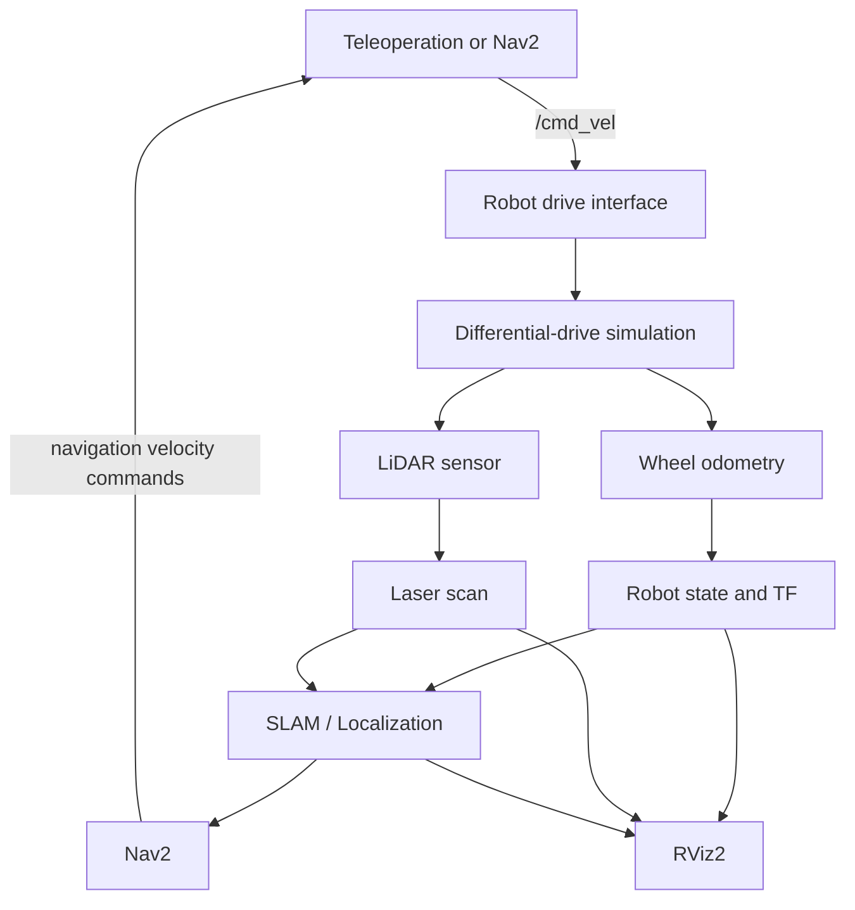

# System Architecture

This document describes the intended software architecture for the ROS 2 mobile robot simulation. It is a design reference; individual components remain planned until implemented and tested.

## System overview

The robot is intended to use a differential-drive base with simulated wheel odometry and a 2D LiDAR sensor. ROS 2 nodes will connect the robot description, simulation, sensor processing, mapping, localization, and navigation.

## Planned data flow



## Main subsystems

### 1. Robot description
Defines the robot links, joints, dimensions, wheel placement, and sensor mounting frames using URDF/Xacro.

### 2. Simulation
Provides a virtual environment in which the robot model can be spawned and its motion and sensors can be evaluated.

### 3. Drive and odometry
The differential-drive model receives velocity commands and provides odometry information. The exact controller and topic configuration will be documented after implementation.

### 4. LiDAR
A simulated 2D LiDAR is planned for publishing range measurements. Its scan topic, frame ID, update rate, and field of view will be recorded after verification.

### 5. Mapping and localization
SLAM Toolbox is planned for map creation. A localization configuration, such as AMCL with a saved map, is planned for repeatable navigation tests.

### 6. Navigation
Nav2 is planned to provide path planning, controller execution, and goal-based navigation.

### 7. Visualization and diagnostics
RViz2 and ROS 2 command-line tools will be used to inspect topics, TF frames, maps, sensor output, and navigation behaviour.

## Planned TF frame relationship

The intended frame structure is:

```text
map
└── odom
    └── base_footprint
        └── base_link
            ├── left_wheel_link
            ├── right_wheel_link
            └── lidar_link
```

The final TF tree may include additional frames depending on the selected robot model and ROS 2 controllers.

## Planned ROS 2 interfaces

| Interface | Intended purpose |
|---|---|
| `/cmd_vel` | Robot velocity command |
| `/odom` | Odometry estimate |
| `/scan` | 2D LiDAR measurements |
| `/tf` | Transform data |
| `/tf_static` | Fixed transforms |
| `/map` | Occupancy grid map |

Topic names and message types will be confirmed against the final configuration.

## Design considerations

- Maintain consistent frame naming.
- Ensure that sensor frame IDs match the TF tree.
- Use simulation time consistently when running in Gazebo.
- Verify command velocity behaviour and emergency stopping before autonomous navigation tests.
- Keep mapping, localization, and navigation configurations modular.
